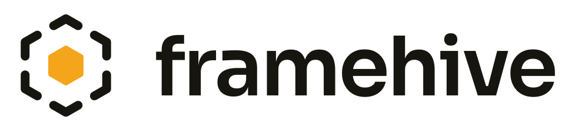

<!--
SPDX-FileCopyrightText: 2026 Framehive contributors
SPDX-License-Identifier: GPL-3.0-or-later
-->

<p align="center">
  <picture>
    <source media="(prefers-color-scheme: dark)" srcset="assets/brand/logo-horizontal-dark.svg">
    
  </picture>
</p>

<p align="center">
  <strong>A photo library that keeps your pictures in your files, not in its database.</strong><br>
  Import, cull, rate and tag photos on Linux and macOS. Written in Rust with a Slint UI.
</p>

<p align="center">
  <a href="https://github.com/polandy/Framehive/actions/workflows/ci.yml"></a>
  <a href="LICENSE"></a>
  
  
</p>

> [!NOTE]
> Framehive is at the very beginning. The requirements, architecture and first specs
> exist; the application does not yet. Nothing is usable today, but everything below is
> what we are building.

## Why Framehive

- **Your files are the source of truth.** Ratings, labels and tags live in standard XMP
  sidecars. The index is only a cache and can be rebuilt at any time. Other photo
  applications that follow the standards see the same metadata, so there is no lock-in.
- **Know for certain that the card can be formatted.** Every imported file is
  checksummed while it is read and verified again at the destination and at every
  backup. A device turns green only when each file is safe in enough places.
- **Built for RAW shooters.** RAW and JPEG pairs form one asset, culling happens in a
  keyboard-driven loupe, and thumbnails come from embedded previews, so a grid of
  200,000 photos stays fast.
- **Works with the storage you already have.** One library can span several
  locations: local disks, sync folders, network shares and drives that are sometimes
  offline.
- **Scriptable.** The same core runs headless: `framehive import --profile vacation …`.

## What is planned

| Module | What it does | Phase |
|---|---|---|
| **Import** | Fetch photos and videos from cameras, cards, phones and folders; rename, store, back up in parallel and verify, in the background | MVP |
| **Library** | Browse, view, rate, tag, cull, search and build albums | MVP |
| **People** | Name faces and filter by person | v1 |
| **Map** | Photos by location and geotagging | soon after v1 |
| Editor | Image editing; until then, Framehive hands photos to an external editor | later |

The full plan is in the [roadmap](docs/requirements/10-roadmap.md).

## How it is built

- **Modular.** Each feature is a module behind a small kernel. Modules never depend on
  each other, and only the apps know concrete adapters
  ([architecture](docs/architecture/README.md)).
- **Specified before it is coded.** Every feature has a spec in [`specs/`](specs/), and
  every acceptance criterion has a test that points back to it.
- **Few dependencies.** Standard library and small, well-tested own code first; a
  library only for large or security-critical problems ([ADR 0009](docs/adr/0009-minimal-dependencies.md)).
- **Reproducible and deterministic.** A pinned toolchain in a Nix shell, and tests
  without sleeps, wall clock or network.
- **Developed by AI agents, readable by humans.** Every rule is enforced by
  `cargo xtask ci`, not by hope ([ADR 0008](docs/adr/0008-development-by-ai-agents.md),
  [CLAUDE.md](CLAUDE.md)).

## Getting started

The first thing that runs is the command-line import. It copies the photos and
videos of a folder or a mounted memory card into a library folder, sorted into
folders by capture date, verifies every copy, and skips files that are already
there:

```sh
cargo run --locked -p framehive-cli -- import <source> <destination> [--dry-run]
```

`--template` sets the folders and names, `--on-conflict add_suffix|skip|fail` decides
what happens when a name is taken, and `--dry-run` prints the plan without copying.
`framehive import --help` describes every argument.

With Nix, the flake builds the `framehive` command with the pinned toolchain. Run it
without installing, or install it into your profile:

```sh
nix run . -- import <source> <destination> [--dry-run]
nix profile install .
```

To work on the code:

```sh
nix develop          # or: direnv allow
cargo xtask ci       # every check, exactly as CI runs it
```

Changes reach `main` only through pull requests, see
[docs/pull-requests.md](docs/pull-requests.md).

## Documentation

| Topic | Document |
|---|---|
| What we build | [docs/requirements/](docs/requirements/README.md) |
| Feature behaviour | [specs/](specs/) |
| Architecture | [docs/architecture/](docs/architecture/README.md) |
| Decisions | [docs/adr/](docs/adr/) |
| Logo, colours and type | [assets/brand/](assets/brand/README.md) |
| Rules for contributors and AI agents | [CLAUDE.md](CLAUDE.md) |
| Changes | [CHANGELOG.md](CHANGELOG.md) |

## License

Framehive is free software under the GPL-3.0-or-later, see [LICENSE](LICENSE) and
[ADR 0014](docs/adr/0014-license-gpl-3-or-later.md).
